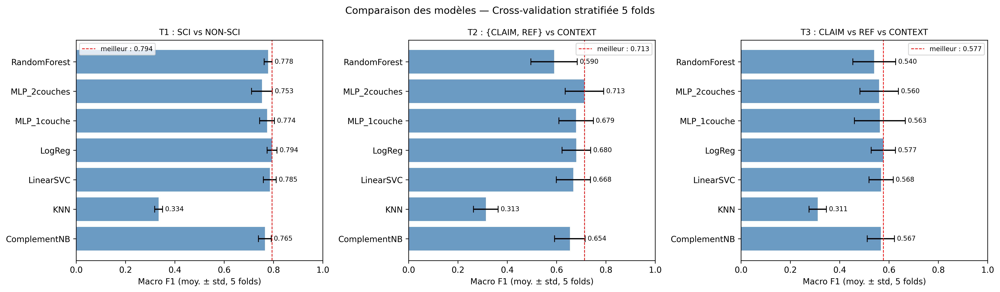
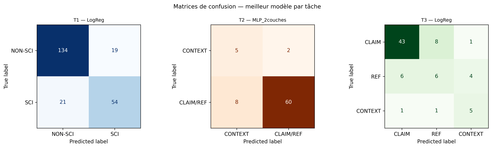
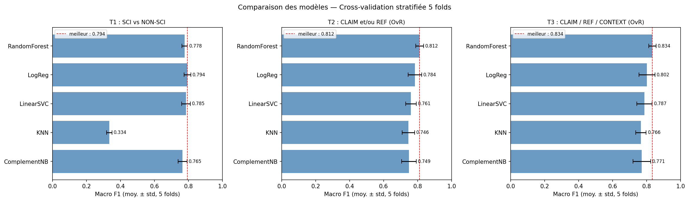
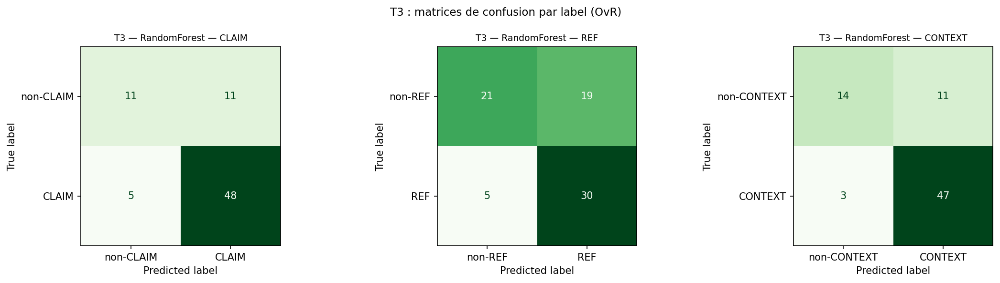

# SciTweets — Classifying tweets by their relation to science

  <em>Machine Learning project (HAI817) — M1 Computer Science, Université de Montpellier — March to May 2026</em>

---

## Overview

Can a model tell whether a tweet talks about science, and in what way?
Using the **SciTweets** dataset (1,140 annotated tweets), we built a full text-classification pipeline (cleaning, TF-IDF, class-imbalance handling, model comparison, hyperparameter tuning) for three tasks:

| Task | Question | Data |
|---|---|---|
| **T1** | Is the tweet science-related? **SCI** vs **NON-SCI** | all 1,140 tweets |
| **T2** | Does it make a claim or cite a reference, or only give context? **{CLAIM, REF}** vs **CONTEXT** | 375 SCI tweets |
| **T3** | Which kind of scientific tweet? **CLAIM** vs **REF** vs **CONTEXT** | 375 SCI tweets |

We compared **7 models**: Logistic Regression, Linear SVC, Random Forest, Complement Naive Bayes, k-NN and two MLPs (1 and 2 hidden layers).

---

## Results

Main metric: **macro F1**, which gives the same weight to every class (accuracy alone is misleading here, since 67 % of tweets are NON-SCI).

| Task | Best model | Macro F1, 5-fold CV (mean ± std) | Macro F1 on held-out test set, after GridSearch |
|---|---|---|---|
| T1 — SCI vs NON-SCI | Logistic Regression | **0.794** ± 0.020 | **0.800** |
| T2 — {CLAIM, REF} vs CONTEXT | MLP, 2 layers | **0.713** ± 0.078 | **0.712** |
| T3 — CLAIM vs REF vs CONTEXT | Logistic Regression | **0.577** ± 0.049 | **0.606** |

  

  

What we learned:

- **Linear models are the most reliable.** On short, sparse TF-IDF vectors, Logistic Regression and Linear SVC are always among the best, and the MLP only wins on T2, with a high variance. k-NN fails (macro F1 around 0.33), most likely because distances between very sparse vectors carry little information.
- **T2 and T3 are much harder**, for two reasons: few examples (375 SCI tweets) and strong imbalance (only 33 CONTEXT tweets). With 7 CONTEXT tweets in each test fold, scores vary a lot between folds.
- **Most discriminant words** (Logistic Regression coefficients): for SCI, *health, research, cancer, study, risk, climate, scientist*, and the presence of a link; for NON-SCI, *stop, support, report, need*. For CONTEXT, words about the research world rather than findings: *conference, grant, writer, book*.

Full scores (precision, recall, F1, per model and per task) are in [`results/single_label_results.json`](results/single_label_results.json).

---

## A second approach: multi-label classification (One-vs-Rest)

In SciTweets, a scientific tweet can carry **several labels at once** (124 tweets are both CLAIM and REF).
The approach above forces one label per tweet (priority rule CLAIM > REF > CONTEXT).
In [`02_multilabel_ovr.ipynb`](notebooks/02_multilabel_ovr.ipynb), we instead kept the labels as they are and trained **one binary classifier per label** (One-vs-Rest).

| Task (multi-label) | Best model | Macro F1 over labels, 5-fold CV |
|---|---|---|
| T2 — labels [CLAIM, REF] | Random Forest | 0.812 |
| T3 — labels [CLAIM, REF, CONTEXT] | Random Forest | 0.834 |

> **Note:** these scores are **not directly comparable** with the single-label table above. Here, each label is a separate yes/no prediction and the F1 is averaged over labels, whereas the single-label setting asks for one exact class per tweet. The two approaches answer slightly different questions.

  

  

---

## Pipeline

1. **Exploration and sanity checks**: class distribution, tweet length by class, consistency of labels (every SCI tweet has at least one sub-label), no duplicates.
2. **Cleaning**: emojis counted then removed; `@mentions` removed; `#` removed but hashtag words kept; links replaced by a token; non-ASCII characters removed.
3. **Text processing**: tokenisation, stop-word removal, lemmatisation (WordNet).
4. **Vectorisation**: TF-IDF on unigrams and bigrams, with `min_df` / `max_df` to drop very rare and very frequent words.
5. **Class imbalance**: SMOTE oversampling and `class_weight='balanced'`.
6. **Evaluation without data leakage**: stratified 5-fold cross-validation, where TF-IDF and SMOTE are fitted **on the training fold only**; then GridSearchCV on the best model of each task (with an `imblearn` pipeline).
7. **Analysis**: confusion matrices and most discriminant features per class.

---

## Repository

| File | Content |
|---|---|
| [`notebooks/01_single_label.ipynb`](notebooks/01_single_label.ipynb) | Main notebook: exploration, cleaning, the 3 tasks, model comparison, GridSearch, discriminant features |
| [`notebooks/02_multilabel_ovr.ipynb`](notebooks/02_multilabel_ovr.ipynb) | Multi-label variant (One-vs-Rest) for T2 and T3 |
| `figures/` | Charts shown in this README |
| `results/` | All cross-validation and test scores (JSON) |

The notebooks are written in French and were run on Google Colab.

---

## Running the notebooks

1. **Get the data.** The dataset is not included in this repository. SciTweets is freely available from GESIS: [doi.org/10.7802/2434](https://doi.org/10.7802/2434). Export it as a tab-separated file named `scitweets_export.csv`, with the columns `tweet_id`, `text`, `science_related`, `scientific_claim`, `scientific_reference`, `scientific_context`.
2. **Open a notebook in Google Colab** and set `my_local_drive` (in the *Configuration* section) to the Drive folder that contains `scitweets_export.csv`.
3. **Install the dependencies** if needed: `pip install -r requirements.txt`.

---

## Reference

Hafid, S., Schellhammer, S., Bringay, S., Todorov, K., & Dietze, S. (2022). *SciTweets — A Dataset and Annotation Framework for Detecting Scientific Online Discourse.* CIKM 2022. [arXiv:2206.07360](https://arxiv.org/abs/2206.07360)

## Team

Project carried out by a team of four students:

- Chirine El Aidouni
- Akidat Moussa-Nizar
- Nassera Nabgaoui
- Paul Maurin
